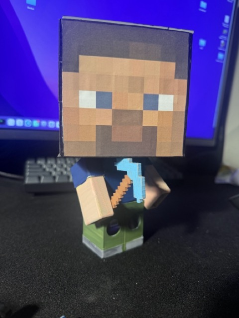
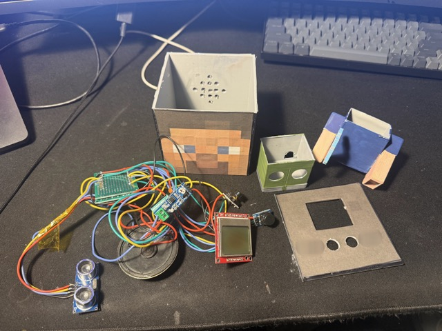
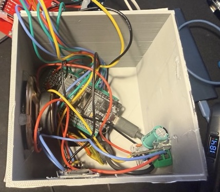
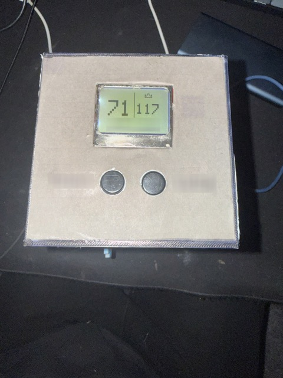

# McSteve

An ESP32 inside a big blocky-miner figurine that nags two kids to drink water.

- **Motion nag:** an ultrasonic sensor spots someone walking past, and Steve plays a random silly threat ("Without water you turn into a wrinkly cucumber! Drink water!").
- **Water tracker:** each kid has a button. Pressing it after a drink bumps their counter and plays a random congratulation. The counters show on a Nokia 5110 LCD, with a crown over whoever's ahead.
- **Web UI:** trigger sounds, change settings, adjust or reset counters, manage the audio files on the SD card, and read the live log.
- **Quiet hours:** outside the active window (07:00–21:00 by default) Steve stays silent and the LCD shows a sleeping creeper.

All voice lines are pre-generated with ElevenLabs TTS, converted to WAV, and played from an SD card through the ESP32's built-in DAC.

The two kids are called **Timmy** and **Luke** in this repo. Swap in your own names (see [Customizing](#customizing)).

---

## Repo layout

| Path | What it is |
|---|---|
| `arduino/` | Arduino sketch (ESP32 firmware) |
| `arduino/secrets.example.h` | Template for WiFi and OTA credentials |
| `lines_*.txt` | Voice lines for TTS, one per line |
| `generateAudio.mjs` | Turns `lines_*.txt` into MP3s with ElevenLabs |
| `convert_to_wav.sh` | Turns the MP3s into WAVs the ESP32 can play |
| `PINOUT.md` | Wiring for the SD card, audio and sensor |
| `README/` | Photos used in this README |

---

## Parts required

| Part | Notes |
|---|---|
| ESP32 DevKit V1 (ESP-WROOM-32, 30-pin) | |
| HC-SR04 ultrasonic sensor | Powered from 5V (VIN) |
| Nokia 5110 LCD (PCD8544) | 3.3V breakout board |
| Micro-SD card module (SPI) + micro-SD card | Card formatted FAT32 |
| LM386 amplifier module | Powered from 5V (VIN) |
| Small 8 Ω speaker | |
| 100 Ω resistor + 0.1 µF capacitor | RC low-pass filter between the DAC pin and the amp |
| 2× push-button modules | 3-pin (VCC / GND / OUT), active HIGH |
| Perfboard and jumper wires | |
| 5V USB power supply | Powers the ESP32 over USB |
| 3D-printed enclosure and figurine | Head box with speaker grille, LCD/button faceplate, body and legs (the sensor sits in the legs), papercraft skin glued on |

Wiring is in [Hardware](#hardware) and [PINOUT.md](PINOUT.md).

---

## Build order

```
lines_*.txt ──► generateAudio.mjs ──► output/*.mp3 ──► convert_to_wav.sh ──► output_wav/*.wav ──► SD card ──► flash ESP32
```

### 1. Install tools

- Node.js 18+ and npm
- `ffmpeg` on your `PATH`, for the conversion step (`brew install ffmpeg` on macOS)
- Arduino IDE 2.x (or `arduino-cli`)

```sh
npm install
```

### 2. Add your ElevenLabs key

Create a `.env` file in the project root:

```
ELEVENLABS_API_KEY=your-key-here
```

The voice and model are set at the top of `generateAudio.mjs` (`VOICE_ID`, `MODEL_ID`).

### 3. Write or edit the voice lines

| File | Played when | SD folder |
|---|---|---|
| `lines_detection.txt` | Someone walks past the sensor | `/detection` |
| `lines_scheduled.txt` | Something calls `/scheduled` (see [Scheduled reminders](#scheduled-reminders)) | `/scheduled` |
| `lines_congrats_timmy.txt` | Timmy presses his button | `/congratulations_timmy` |
| `lines_congrats_luke.txt` | Luke presses his button | `/congratulations_luke` |
| `lines_welcome.txt` | Boot, during active hours | `/startup.wav` (single file) |

Write one line per row; blank lines are skipped. Keep each line under about 4 seconds of speech. The small speaker and the RC filter muddle anything longer.

### 4. Generate MP3s

Edit the `FILES` array in `generateAudio.mjs` and uncomment the sets you want to (re)generate. Each run makes one API call per line, so don't regenerate what you already have.

```sh
node generateAudio.mjs
```

The output is `output/<set>/1.mp3`, `2.mp3`, and so on, numbered in line order.

### 5. Convert to WAV

The firmware plays only 16-bit mono PCM WAV at 22,050 Hz. The script converts every `.mp3` in one folder into a matching `.wav`:

```sh
./convert_to_wav.sh output/detection        output_wav/detection
./convert_to_wav.sh output/scheduled        output_wav/scheduled
./convert_to_wav.sh output/congrats/timmy   output_wav/congrats/timmy
./convert_to_wav.sh output/congrats/luke    output_wav/congrats/luke
./convert_to_wav.sh output/welcome          output_wav/welcome
```

Rename `output_wav/welcome/1.wav` to `startup.wav`.

### 6. Prepare the SD card

Format it as **FAT32**. The folder names on the card don't match the `output_wav/` names, so copy each one into the right place:

```
/
├── startup.wav                  ← output_wav/welcome/startup.wav
├── detection/*.wav              ← output_wav/detection/
├── scheduled/*.wav              ← output_wav/scheduled/
├── congratulations_timmy/*.wav  ← output_wav/congrats/timmy/
└── congratulations_luke/*.wav   ← output_wav/congrats/luke/
```

The firmware creates `config.txt` (settings) and `water.txt` (counters) on its own; don't create them yourself.

Once the device is running, you can also upload, delete and organise files from the web UI instead of pulling the card out.

### 7. Flash the firmware

1. Copy `arduino/secrets.example.h` to `arduino/secrets.h` and fill in your WiFi name and password and an OTA password. `secrets.h` is gitignored.
2. Install the libraries (Library Manager):

   | Library | Author | Version |
   |---|---|---|
   | ESP8266Audio | Earle F. Philhower, III | 2.4.1 |
   | Adafruit PCD8544 Nokia 5110 LCD library | Adafruit | 2.0.3 (pulls in Adafruit GFX and Adafruit BusIO) |

3. Board: **ESP32 Dev Module** (from the esp32 board package by Espressif).

   > **Known issue: core version conflict.** ESP8266Audio 2.4.1 needs esp32 core **3.x**. With core 2.0.x it fails with `driver/i2s_std.h: No such file`. But `arduino/display.cpp` drives the backlight with `ledcSetup`/`ledcAttachPin`, and core 3.x removed those. Until the backlight code is ported to the core 3.x LEDC API, building takes either core 2.0.x with an older ESP8266Audio release, or core 3.x with that port.

4. Open `arduino/arduino.ino`, insert the SD card, and upload over USB.

After the first flash, you can update over WiFi (Arduino OTA). The device shows up as **`steve`** in the IDE's port list and asks for your OTA password.

### 8. Use it

On boot the LCD shows the device's IP address. Open `http://<that-ip>/` for the web UI.

---

## Hardware

Wiring for the SD card, audio and ultrasonic sensor is in [PINOUT.md](PINOUT.md). The rest is defined in code:

| Part | GPIO | Defined in |
|---|---|---|
| Timmy's button | 13 | `arduino/arduino.ino` (`BTN_1_PIN`) |
| Luke's button | 14 | `arduino/arduino.ino` (`BTN_2_PIN`) |
| LCD CE / DC / RST | 4 / 16 / 17 | `arduino/display.h` |
| LCD backlight (PWM) | 2 | `arduino/display.h` |
| LCD DIN / CLK | 23 / 18 | shared SPI bus with the SD card |

The buttons are 3-pin push-button modules, read active-HIGH. Wire VCC to 3V3, GND to GND, and OUT to GPIO 13 / 14. The module has its own resistor, so you don't need an extra one. If you use bare 2-pin buttons instead, wire each between 3V3 and its GPIO and add a 10k pull-down to GND.

For the full parts list, see [Parts required](#parts-required).

---

## Settings

All of these can be changed live in the web UI and are saved to `/config.txt` on the SD card:

| Setting | Default |
|---|---|
| Trigger distance | 100 cm |
| Motion cooldown | 30 s |
| Water button cooldown (per kid) | 15 min |
| Active hours | 07–21 |
| LCD backlight | 100% |

The timezone is hardcoded to Eastern European Time in `arduino/arduino.ino` (`configTzTime`). Change the POSIX TZ string for your location, or the active hours will be off.

### Scheduled reminders

The firmware doesn't play `/scheduled` lines by itself. They play when something requests `http://<device-ip>/scheduled`: the **SCHEDULED** button in the web UI, a cron job (`curl http://<ip>/scheduled`), Home Assistant, and so on.

### HTTP endpoints

| Endpoint | Does |
|---|---|
| `GET /detection` | Play a random detection line |
| `GET /scheduled` | Play a random scheduled line |
| `GET /stop` | Stop playback |
| `GET /status` | JSON: trigger distance, cooldown, playing, active |
| `GET /water` | JSON: both counters |
| `POST /water_set?name=timmy&delta=1` | Adjust a counter (+1 also plays a congrats line) |
| `POST /water_reset` | Zero both counters |

---

## Customizing

To use your own kids' names, rename them everywhere, keeping each spelling's case:

- `timmy` / `luke` (lowercase) are the keys in `water.txt`, the web/JSON names, and part of the SD folder names (`congratulations_<name>`). They have to match the folders on the card.
- `Timmy` / `Luke` are the variable names and the web UI labels.
- `TIMMY` / `LUKE` are the LCD labels. Each half of the LCD fits 7 characters, so long names need the cursor X in `updateDisplay()` (`arduino/display.cpp`) adjusted.
- Rename `lines_congrats_*.txt` and the matching SD folders to match.

If you rename on a device that's already running, also rename the keys inside `/water.txt` on the card, or the counters will reset to 0.

---

## License

[MIT](LICENSE)

---

## Photos

<table>
  <tr>
    <td align="center" width="50%">
      <br>
      <sub>The finished figurine. The HC-SR04 "eyes" sit in the legs.</sub>
    </td>
    <td align="center" width="50%">
      <br>
      <sub>Before assembly: head box with speaker grille, body, legs, LCD/button faceplate and the electronics.</sub>
    </td>
  </tr>
  <tr>
    <td align="center" width="50%">
      <br>
      <sub>Inside the head: ESP32 on perfboard, speaker and amp module.</sub>
    </td>
    <td align="center" width="50%">
      <br>
      <sub>The water tracker panel showing the sleep screen: a dozing creeper and both kids' counts.</sub>
    </td>
  </tr>
</table>
